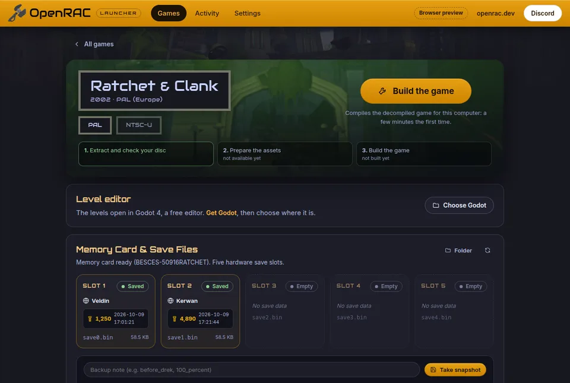

# OpenRAC

Decompilations of the PlayStation 2 Ratchet & Clank games, in one place:
Ratchet & Clank, Going Commando, Up Your Arsenal and Deadlocked. Each game is
being turned back into C that compiles to a byte-identical copy of the
original program. That match is how correctness is proven. C that compiles
and runs on PC is the long-term goal.

OpenRAC holds no game code or assets. You build it from your own discs.

## Progress

<!-- progress:begin -->
<!-- Generated by tools/openrac.py tables from games/*/game.json; do not edit. -->
| Game | Version | Code matched | Functions | Fuzzy |
|---|---|---:|---:|---:|
| Ratchet & Clank | SCES_509.16 ([`games/rac1/pal`](games/rac1/pal)) | 78.51% (2,914,880 / 3,712,808 bytes) | 4,215 / 5,109 | 79.79% |
| Ratchet & Clank | SCUS_971.99 ([`games/rac1/ntsc`](games/rac1/ntsc)) | 68.55% (2,431,648 / 3,547,428 bytes) | 3,549 / 4,237 | 70.14% |
| Ratchet & Clank: Going Commando | SCUS_972.68 ([`games/rac2/ntsc`](games/rac2/ntsc)) | 1.09% (531,224 / 48,788,176 bytes) | not counted | – |
| Ratchet & Clank: Up Your Arsenal | SCUS_973.53 ([`games/rac3/ntsc`](games/rac3/ntsc)) | 1.28% (164,764 / 12,838,776 bytes) | 1,292 / 31,316 | 1.28% |
| Ratchet: Deadlocked | SCUS_974.65 ([`games/rac4/ntsc`](games/rac4/ntsc)) | 0.51% (26,572 / 5,175,440 bytes) | 243 / 15,056 | 0.51% |
<!-- progress:end -->

Each project measures its own scope, so compare percentages within a game,
not between games ([progress/](progress/README.md) explains each). The
community hub for these projects is [openrac.dev](https://openrac.dev/).

## Games

<!-- games:begin -->
<!-- Generated by tools/openrac.py tables from games/*/game.json; do not edit. -->
| Game | Version | Directory | Decompiles | Builds on |
|---|---|---|---|---|
| Ratchet & Clank (2002) | PAL (Europe) `SCES_509.16` | [`games/rac1/pal`](games/rac1/pal) | The boot executable SCES_509.16 and the 19 level programs (overlays), matched function by function. | macOS or Linux through Docker (linux/386 image with Wine); SN ProDG toolchain you supply |
| Ratchet & Clank (2002) | NTSC-U (North America) `SCUS_971.99` | [`games/rac1/ntsc`](games/rac1/ntsc) | The boot executable SCUS_971.99 and the 19 level programs, as per-function units. | Linux or WSL; macOS through ./setup.sh --docker; toolchains downloaded and built by setup.sh |
| Ratchet & Clank: Going Commando (2003) | NTSC-U (North America) `SCUS_972.68` | [`games/rac2/ntsc`](games/rac2/ntsc) | The boot executable SCUS_972.68 and its 27 level overlays: the whole program rebuilds from reconstructed assembly, and C replaces it function by function. | Windows with WSL for the C compiler; SN ProDG 2.0 assembler and linker you supply |
| Ratchet & Clank: Up Your Arsenal (2004) | NTSC-U (North America) `SCUS_973.53` | [`games/rac3/ntsc`](games/rac3/ntsc) | Three programs extracted from the disc with Wrench, each rebuilt byte for byte: frontbin.elf (the frontend and menu program), boot_elf.elf (the main executable) and i5bootn.elf (the launcher); the level programs are counted for progress. | Windows with SN ee-gcc 2.95.3 v1.36 (and Sony 2.9-ee-991111 for library ranges); macOS (wibo-macos, natively) and Linux through tools/build.py with wibo |
| Ratchet: Deadlocked (2005) | NTSC-U (North America) `SCUS_974.65` | [`games/rac4/ntsc`](games/rac4/ntsc) | The game image packed inside the boot executable SCUS_974.65 (core, network and resident level code: 8,027 functions) and the 47 level overlays (24 campaign, 23 multiplayer), compared function by function; there is no linked image yet. | macOS or Linux through Docker (rac1/pal's linux/386 image with Wine); SN ProDG toolchain you supply |
<!-- games:end -->

Each version is a self-contained project that you build and work on from its
own directory. The game pages ([games/](games/README.md)) explain how the
versions relate and where to start.

## Getting started

```sh
git clone git@github.com:OpenRAC/OpenRAC.git && cd OpenRAC
# Put images of your own discs in baserom/ (see baserom/README.md), then:
python3 tools/openrac.py discs     # identify and check them
python3 tools/openrac.py setup     # put each game's inputs where its build expects them
```

`setup` ends by printing the next command for each game. The compilers are
proprietary and not included; [toolchains/README.md](toolchains/README.md)
says what each game needs and where its builders get it. Then follow the
game's README, for example [games/rac1/pal](games/rac1/pal/README.md).

The level editor turns your own disc's levels into a Godot 4 project you can
edit ([editor/README.md](editor/README.md)):

```sh
python3 editor/extract.py godot baserom/SCES_509.16.iso assets/godot
```

The goal for playing is a **native PC port** of each game, built the way
OpenGOAL ported Jak and Daxter: the decompiled code compiled for the PC, a
renderer of OpenRAC's own, the assets extracted once from your own disc. No
emulation. [port/](port/README.md) is its code: it builds Ratchet & Clank
(PAL)'s whole decompilation into a native program, which runs the game's
`main` with OpenRAC's renderer and sound; what is still assembly is
logged and skipped. [docs/port](docs/port/README.md) has the design, the
studies of the decompiled code and the order of work.

## The launcher

The easiest way in is the desktop launcher ([launcher/](launcher/README.md)),
OpenRAC's answer to OpenGOAL's: set a game up from your disc, build the
native port and play it, manage its saves, open its levels in the editor.
With developer tools on, it also runs every game's builds and checks.



```sh
cd launcher && corepack enable && yarn install && yarn tauri dev
```

## Repository layout

```
games/       one directory per game, one per version inside (pal, ntsc)
editor/      the Godot level editor and its extractor
launcher/    a desktop app to set up, build and play the games (in progress)
port/        the native PC port: runtime, hostgen, renderer, platform, the games' programs
tools/       openrac.py (discs, setup, progress) and sources.py (imports)
docs/        policy, engine knowledge, toolchains and workflows across games
progress/    consolidated progress, generated
shared/      the function map across the games, generated
baserom/     your disc images (ignored by git)
toolchains/  compilers you supply (ignored by git)
```

[docs/LAYOUT.md](docs/LAYOUT.md) gives the rules behind it, and
[docs/README.md](docs/README.md) maps every document in the repository.

## Contributing

Read [CONTRIBUTING.md](CONTRIBUTING.md) and the
[sourcing policy](docs/policy/SOURCING.md): your own disc is the evidence, and
Sony SDK source, samples and headers, and leaked or NDA material, are never
used. Commits follow Conventional Commits (`feat(rac1/pal): ...`). AI agents
also follow [AGENTS.md](AGENTS.md). Decisions the group still has to make are
in [docs/policy/OPEN_QUESTIONS.md](docs/policy/OPEN_QUESTIONS.md).

## Supported discs

Only these releases are supported. `tools/openrac.py discs` checks your
images against them; images are recognised by content, not by file name.

<!-- discs:begin -->
<!-- Generated by tools/openrac.py tables from games/*/game.json; do not edit. -->
| Game | Version | Serial | Size (bytes) | CRC32 | MD5 | SHA-1 | SHA-256 |
|---|---|---|---:|---|---|---|---|
| Ratchet & Clank | PAL (Europe), disc v2.00 | `SCES_509.16` | 4,214,784,000 | `e417c4b2` | `32b8347b2bb80cd30d30ba0601ebb0ee` | `ef304c641c7cd426ba492707dda5974679befbc0` | `0f18a6c84cd8d727ec8c21000a236ed5ce2f279cbb8d0682fa9747199ef73260` |
| Ratchet & Clank | NTSC-U (North America), disc v1.00 | `SCUS_971.99` | 4,214,095,872 | `960318d0` | `a62a8ae0e44c2580be38c82f48b7d181` | `aee9275384f739c9b24cd5de6f7e200292db7b01` | `ab849fe7cc9cc81c487d61b0d3ea15b5849943481b6a6ebf4d9aa9cf7bc40d9d` |
| Ratchet & Clank: Going Commando | NTSC-U (North America), disc v1.01 | `SCUS_972.68` | 3,828,350,976 | `6d1fc798` | `3cbbb5127ee8a0be93ef0876f7781ee8` | `f2cfaf0eb12b3c0d8fd6db7aa49ce032e8a6020b` | `9db2e33e276133cc283647fa3279b37911955e123d6199d10065547eaa9b1ce5` |
| Ratchet & Clank: Up Your Arsenal | NTSC-U (North America), disc v1.00 | `SCUS_973.53` | 4,379,377,664 | `2b9b91f7` | `ba9f2b38c7346e7b6e5b8e87717d5893` | `b080139c5a94688ef9472b78d5f5585a756d1ee4` | `d2bb15c7c5b2205db868713fc0362c2b10e87751ca5bcc4e96c1e244a8c42444` |
| Ratchet: Deadlocked | NTSC-U (North America), disc v1.00 | `SCUS_974.65` | 4,356,898,816 | `66eb35f4` | `c1e1992076becc7de5aa70ef1de8bcd0` | `a85482348f741d848dd2ff4e4c3ba7c2c40f431d` | `dda48512e9b7609f69a49146ab239c4ebda7f13cf3d06397f19f6f3ce155a42b` |
<!-- discs:end -->

The boot executable inside each:

<!-- boot:begin -->
<!-- Generated by tools/openrac.py tables from games/*/game.json; do not edit. -->
| Game | Version | Boot executable | Size (bytes) | CRC32 | MD5 | SHA-1 | SHA-256 |
|---|---|---|---:|---|---|---|---|
| Ratchet & Clank | PAL (Europe) | `SCES_509.16` | 1,388,100 | `3b34cb54` | `d86429e2eca4e1da7d7f1cc656af2574` | `79956931bd62fafd8d20fa2eae796dbaf2e15e83` | `17f8a846329fd10798cb97847e9610e5eecd1867668420ed627b2292a96b122b` |
| Ratchet & Clank | NTSC-U (North America) | `SCUS_971.99` | 1,383,028 | `bb737a9f` | `0c081d4e0353b419d95e5f95eb0ebacb` | `72fd1de379dafd8f243dceeb3be50980f3fd3cd5` | `e050581032e4bb3f20341307da5b69b76f1574910519155380ea771e55c3c0c9` |
| Ratchet & Clank: Going Commando | NTSC-U (North America) | `SCUS_972.68` | 2,618,684 | `0fa89158` | `e514263cd9b01cad088839fbe8585e1e` | `bacda860cbd6723142e86db56f197e47e728970f` | `36d5814d8d95328d5839612ccdf7a2e7ecac0b6f868d3ad4bb2e98411f734b4a` |
| Ratchet & Clank: Up Your Arsenal | NTSC-U (North America) | `SCUS_973.53` | 771,008 | `01affd24` | `c6075c4a296f656648bc9f64f4f1b09b` | `601012bb03ef1213ad1253baebae8a071b8a7df7` | `200068cb4186715521cdc1c20bc6c5a88054d0da54aa336ffdb2022633351c7d` |
| Ratchet: Deadlocked | NTSC-U (North America) | `SCUS_974.65` | 1,692,216 | `eebbaace` | `9e33838c3939099d614963063544df3e` | `aa91b1c3b9b1a244320c47580b77342ef9856e95` | `2f305ab0ed47f148f599ef8769a534adf4080307aa11ab26a7966dedec897ed6` |
<!-- boot:end -->

## Credits and licensing

OpenRAC brings together rac1-decomp, Lombyte, rac2-decomp, rac3-uya-decomp
and rac-deadlocked-decomp ([docs/SOURCES.md](docs/SOURCES.md)); the people behind
them are in [CREDITS.md](CREDITS.md). Each project keeps its own license
([LICENSE.md](LICENSE.md)), and third-party work is listed in
[THIRD_PARTY_NOTICES.md](THIRD_PARTY_NOTICES.md).

Ratchet & Clank is a trademark of Sony Interactive Entertainment; the games
were developed by Insomniac Games. OpenRAC is an unofficial fan project, not
affiliated with or endorsed by either.
