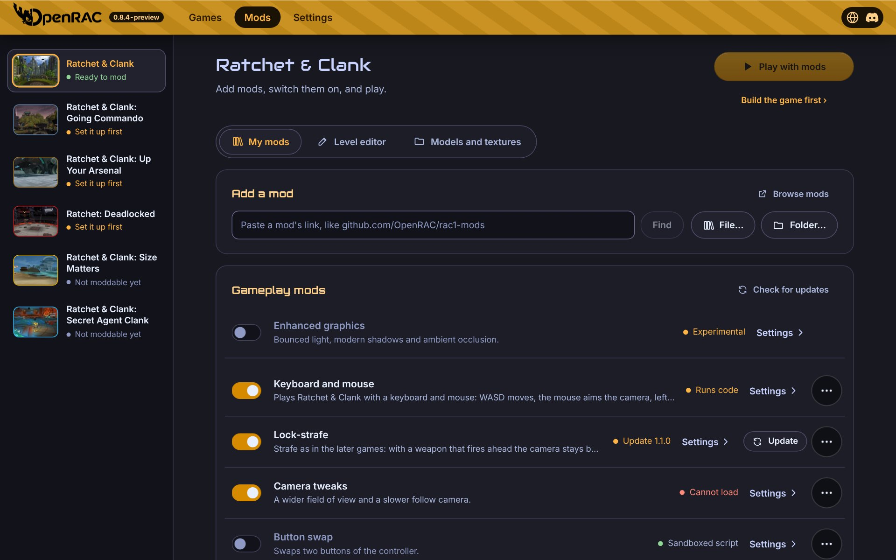

<h1 align="center">
  <a href="https://openrac.dev/">
    <picture>
      <source media="(prefers-color-scheme: dark)" srcset="docs/assets/openrac-logo-dark.svg">
      
    </picture>
  </a>
</h1>

  <strong>Ratchet &amp; Clank on PC, natively.</strong> 
  The PlayStation 2 games, decompiled back into C and rebuilt for Windows, macOS, Linux and Android.

  
  
  
  

  <a href="#play">Play</a> ·
  <a href="#progress">Progress</a> ·
  <a href="#make-mods">Make mods</a> ·
  <a href="#help-out">Help out</a> ·
  <a href="docs/README.md">Docs</a>

  

## What is OpenRAC?

OpenRAC brings the PlayStation 2 Ratchet & Clank games to PC as real native games. No emulator.

- **Playable now:** Ratchet & Clank (PAL, Europe).
- **In progress:** Going Commando, Up Your Arsenal, Deadlocked, Size Matters and Secret Agent Clank.
- **How:** each game is decompiled into C that rebuilds the original exactly, then built for your PC.
- **No game files included:** models, textures, sound and levels come from your own disc.

## Play

1. [Download the launcher](https://github.com/OpenRAC/OpenRAC/releases/latest) and install it.
2. Open it and pick the folder with your disc images (`.iso`).
3. Press **Play**.

The launcher sets your games up for you. Nothing else to install, and no game is ever downloaded.

- [Supported discs](baserom/README.md)
- [The games and their versions](games/README.md)

## Progress

How much of each game's code is decompiled. Follow it on [openrac.dev](https://openrac.dev/#progress).

<!-- badges:begin -->
<!-- Generated by tools/openrac.py tables from games/*/game.json; do not edit. -->

  
  
  
  
  
  
  

<!-- badges:end -->

## Make mods

The launcher's **Mods** tab opens your levels in [Godot 4](https://godotengine.org/). Move enemies, crates and scenery, then play.

  

- [Level editor](editor/README.md)
- [Mod SDK](docs/port/MODS.md), to change how things behave

## Help out

Test and report bugs, decompile functions, or work on the launcher, the port or the editor.

- [Developer guide](docs/DEVELOPING.md): set up a checkout and build everything
- [Contributing](CONTRIBUTING.md): ground rules and commit style
- [Sourcing policy](docs/policy/SOURCING.md): what may and may not be used
- [All documents](docs/README.md)

## Credits and license

OpenRAC brings several decompilation projects together.

- [Credits](CREDITS.md): the people behind them
- [Sources](docs/SOURCES.md): where each project came from
- [Licenses](LICENSE.md) and [third-party notices](THIRD_PARTY_NOTICES.md)

OpenRAC is an unofficial fan project, not affiliated with or endorsed by the owners of Ratchet & Clank ([trademarks](LICENSE.md#trademarks)).
