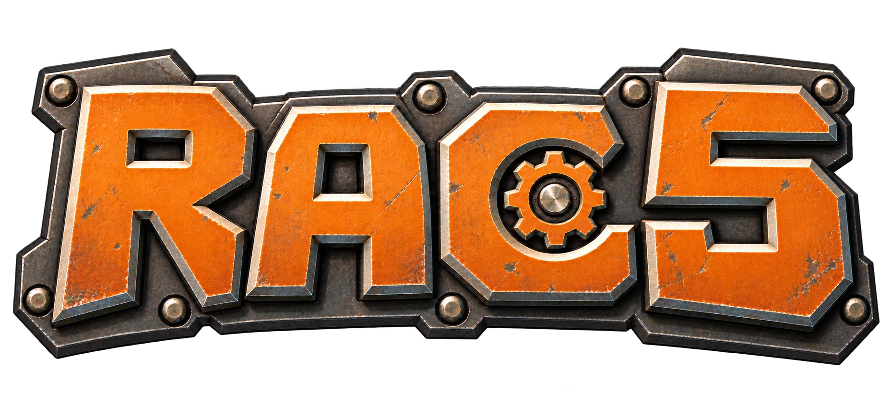

<p align="center">
  
</p>
<p align="center"><strong>Ratchet &amp; Clank: Size Matters</strong></p>

<p align="center"><em>Original project artwork; no game assets.</em></p>

An early matching-decompilation workspace for the **USA PlayStation 2** version
(`SCUS_976.15`, `SYSTEM.CNF` version `1.00`). The layout follows the useful
parts of [OpenRAC's RAC2 project](https://github.com/OpenRAC/rac2-gc-decomp):
authored source belongs in `src/`, game-derived material stays local, and a function
only counts as matched after a byte-identical build. This repository does **not**
yet have a general qualified compiler or a complete retail function catalogue.
The [ByteMatch dashboard](https://bytematch.dev/OpenRAC/rac5-sm-decomp) uses a
**provisional optimistic denominator** for level code; its displayed percentage
is an estimate, not a qualified game-wide match rate. 605 reviewed boot functions, two
shared level functions and one frontend function have narrowly scoped private
whole-program gates.

## What is established

The pinned USA image is **1,744,764,928 bytes**, agrees with its ISO9660 volume
length, and has the SHA-1 in a [public disc catalogue](https://screenscraper.fr/rominfos.php?romid=301580).
Its exact SHA-1, SHA-256 and boot-executable hash are in
[`config/target.json`](config/target.json). A shorter, 150-sector-incomplete
image was excluded. The boot is an ELF32 MIPS executable; the disc has 20
level `.REL` modules plus a frontend module in the SNR2 format. The boot's
embedded table provides 1,803 named symbols. See
[`docs/BOOT-SYMBOLS.md`](docs/BOOT-SYMBOLS.md) and
[`docs/REL-FORMAT.md`](docs/REL-FORMAT.md) for what those counts mean.

The loader's complete relocated output for the frontend and level 01 has
been reconstructed locally and compared byte for byte with paused PCSX2
memory ([evidence and commands](docs/RELOCATED-IMAGE.md)). This qualifies
those two **load images**, not a compiler or authored C/C++ source.
The [complete 498,900-byte boot `.text` section](docs/ASSEMBLY-STATUS.md)
also reassembles byte for byte. With the non-code sections copied from the
private pinned ELF, all **809,872 file-backed boot load bytes** compare equal.
The boot's BSS/runtime state and complete level-program assembly rebuilds
remain open; copied reference data is not decompiled source.
[Candidate code intervals in all 21 SNR2 placements](docs/SNR2-ASSEMBLY-CAMPAIGN.md)
also reassemble exactly before relocation: **36,341,888 cumulative bytes by
placement**, not unique code or matched C. Their other module bytes and most
runtime placements remain open. A new
[complete-program gate for the frontend and level 01](docs/LEVEL-PROGRAM-GATE.md)
checks their full modules and the two previously measured relocated-image
hashes. A separate [level C gate](docs/LEVEL-C-WITNESS.md) now accepts two
authored functions (8 and 72 bytes) at all twenty numbered level placements
and one 476-byte frontend initializer. Two additional C shapes are compiler
controls only.

The boot's embedded labels also yield
[1,315 generated code-label bounds](config/boot/code_intervals.tsv). These are
next-label search limits, not validated function sizes or matches.

A [boot C-object campaign](docs/BOOT-C-WITNESS.md#combined-provisional-c-witness)
also keeps the complete boot `.text`, retail `PT_LOAD` header and raw
file-backed bytes exact after linking authored C bodies together. The campaign
now links **635 compiler-produced C objects**. The generated catalogue identifies
**635 global function bodies**, covering **80,548 boot `.text` bytes** plus 1,228
zero alignment bytes. Every compiled object exposes a global function symbol at
its address, so none is left uncatalogued. Each catalogued
body records its compiled extent and observed terminal transfer in the generated
[`config/boot/witness_boundaries.tsv`](config/boot/witness_boundaries.tsv)
catalogue. Two hundred and sixty-seven reviewed placements live in `src/boot/`;
the others
remain provisional in `nonmatching/`. The
[boot-only acceptance scope](docs/BOOT-MATCH-SCOPE.md) explains why exact loaded
bytes can be assessed separately from ELF packaging.
Inline/global assembly, fixed-register bindings and raw instruction injection do
not qualify as C evidence, even in provisional trials. Hybrid experiments stay
private and their original intervals remain in the assembly baseline. Declaration
labels that only name an ELF symbol are allowed; they emit no instructions.
The [boot gate](docs/BOOT-TRIAL-GATE.md) rebuilds every C object from pinned
local tools, verifies the entire load image in one private run, and counts
**605 boot-only matches** after a successful gate.
The [VU overlay audit](docs/DVP-OVERLAYS.md) also reproduces the boot's 31
non-loaded DVP sections privately. The new
[ELF packaging gate](docs/BOOT-TRIAL-GATE.md) reconstructs the complete
**856,120-byte boot ELF**, including `.reginfo` and section layout, with the
retail SHA-256. Loaded non-code data still comes from the pinned retail input;
this is not a fully source-derived game build.

No other C or C++ match is claimed. The original compiler identity and general level
profiles, most function boundaries and full runtime behavior are still under
investigation. The [scoped progress snapshot](progress/README.md) records the
verified boot, shared-level and frontend matches. A separate, labelled ByteMatch estimate
divides those verified C bytes by provisional candidate code bytes. The
[21-module function audit](docs/LEVEL-FUNCTION-INVENTORY.md)
separates bounded entries from uncertain pointer/table entries and identifies
exact duplicates plus relocation-masked review leads.
The independent Ghidra pass corroborates 91,350 candidate level boundaries;
2,415 masked families pass data-target and closed local-callgraph checks.
A full-module flow pass assigns the 1,590 code-only inside-body disagreements
to review categories, including 21 newly called entry leads. A subsequent
split review selects 6,245 corroborated code segments from 3,729 oversized
candidate intervals, leaving all unselected bytes unique. None of these analyses
turns unresolved function/data boundaries into a game-wide percentage.
An [optimistic shape-only audit](docs/LEVEL-FUNCTION-INVENTORY.md#optimistic-relocation-masked-shape-scenario)
finds a 5,756,360-byte scenario after relocation masking, but shared C source
and data-object identities have not been established for those shapes.
A [code-context and data-anchor review](docs/LEVEL-FUNCTION-INVENTORY.md#repeated-shapes-with-code-context-and-data-anchors)
narrows the separately validated structural scenario to 16,857,360 bytes
after global collision and final-callee checks.
A broader [site-paired code-role review](docs/LEVEL-FUNCTION-INVENTORY.md#site-paired-code-role-review)
tests corresponding calls even when their callees have different bodies. Its
separate conditional normalized-code scenario is 10,088,660 bytes after a
global collision, role and dependency audit; it does not establish shared C
source or a qualified unique-code denominator. Thirteen selected reference
modules reproduce the same savings measured with all twenty retained modules.
Names, symbol addresses and module hashes are research metadata, not proof of
matching code. The [roadmap](docs/ROADMAP.md) tracks the remaining gates.

## Start contributing

You can contribute tools, tests and documentation **without the game**. To
check findings against the retail programs, obtain your own lawful copy of the
USA PS2 disc and make a local ISO with tools you are permitted to use. The
project cannot supply a disc image, executable, extracted level, Sony SDK or
proprietary compiler. Read [LEGAL.md](LEGAL.md) and
[CONTRIBUTING.md](CONTRIBUTING.md) before submitting work.

1. Fork this repository on GitHub, clone your fork, and create a branch from
   the current `master`. Install Python **3.12 or newer**; the initial tools
   use only its standard library. Replace `YOUR-USERNAME` and `topic` below:

   ```sh
   git clone https://github.com/YOUR-USERNAME/rac5-sm-decomp.git
   cd rac5-sm-decomp
   git remote add upstream https://github.com/OpenRAC/rac5-sm-decomp.git
   git fetch upstream
   git switch master
   git merge --ff-only upstream/master
   git switch -c research/topic
   ```

   Run the same checks as CI:

   ```sh
   python -m unittest discover -s tests -v
   python tools/check_repository.py
   ```

2. If your work needs game evidence, keep your ISO outside Git (for example,
   under the ignored `baserom/` directory). Check it against the pinned USA
   target before relying on its addresses or hashes:

   ```sh
   python tools/disc.py inspect "/path/to/your-size-matters-us.iso"
   python tools/disc.py verify "/path/to/your-size-matters-us.iso"
   python tools/disc.py extract-boot "/path/to/your-size-matters-us.iso"
   ```

   `verify` checks the complete ISO and boot against `config/target.json`;
   `extract-boot` writes only to ignored local `baserom/SCUS_976.15` and
   refuses a different or incomplete target. `--allow-short-image` exists for
   diagnosis only and cannot qualify an image for matching. A European,
   Japanese, PSP or differently revised release is a **different target**;
   do not mix its addresses or code with this USA catalogue.

3. Inspect the verified programs and check the committed metadata against
   your own image. These commands report facts locally; `catalogue` without
   `--write` checks whether tracked metadata is current:

   ```sh
   python tools/elf.py baserom/SCUS_976.15
   python tools/boot_symbols.py inspect baserom/SCUS_976.15
   python tools/boot_symbols.py catalogue baserom/SCUS_976.15
   python tools/rel.py inspect "/path/to/your-size-matters-us.iso" --boot baserom/SCUS_976.15
   python tools/rel.py catalogue "/path/to/your-size-matters-us.iso"
   ```

   After measuring a module base in your own run, you can reconstruct its
   private loaded image with `tools/relocate.py` (see the
   [relocation guide](docs/RELOCATED-IMAGE.md)).

   For boot assembly research, the optional
   [`tools/boot_assembly.py`](tools/boot_assembly.py) rebuilds the pinned
   `.text` and checks the file-backed load bytes. It needs your own local SN
   assembler/linker and `rabbitizer==1.16.2`; see the
   [assembly guide](docs/ASSEMBLY-STATUS.md). Generated game-derived files
   remain under ignored `build/`.
   The same optional tools can check [all 21 candidate SNR2 intervals](docs/SNR2-ASSEMBLY-CAMPAIGN.md)
   with `tools/snr2_assembly.py --all` (`tools/frontend_assembly.py` remains
   available for its one placement).

4. Before starting substantial research, check open issues and pull requests
   and state your intended scope in an issue or draft PR. There is **no
   reservation or automated matching queue yet**. Current useful work includes
   documenting the boot loader and SNR2 relocation behavior, establishing a
   complete assembly rebuild, identifying compiler profiles with multiple
   witnesses, reviewing function boundaries, and improving independent tools
   with synthetic tests. Use the [roadmap](docs/ROADMAP.md) and existing
   [loader cross-check](docs/MULTIWORLD-CROSSCHECK.md) to avoid repeating work.

5. Make one focused, reviewable change. Regenerate metadata with the relevant
   tool if your verified input establishes that it is stale; never edit
   generated tables or progress claims by hand. Record the target identity,
   method, evidence, uncertainty, and exact validation commands in the PR.
   Run the tests above again, review `git diff` and staged files for private
   material, then push your branch and open a PR against `master`. If `master`
   advanced while you worked, fetch `upstream` and update your branch before
   rerunning affected checks. **The maintainer merges manually.**

Do not publish ISO/ELF/REL/WAD bytes, extracted assets, assembly listings,
memory dumps, proprietary tools, SDK files, secrets, or personal disc paths.
The `.gitignore` covers common local locations, but review your PR diff
yourself. Public documentation and compatible licensed code may be cited or
reused with credit and their required notices; never use leaked or NDA source
or Sony SDK source, headers or samples. See [LEGAL.md](LEGAL.md) for the
repository's distribution boundary.

## What will count as a match

After the applicable program layout, assembly baseline, function boundary and
compiler profile have been qualified, keep one authored C/C++ definition per
function in `src/`. A useful unaccepted attempt belongs in `nonmatching/`.
Only a qualified toolchain reproducing the **complete retail program bytes at
every applicable placement** can establish a match. Compiling successfully,
matching a few instructions, or comparing masked bytes cannot. The
[reproducible boot gate](docs/BOOT-TRIAL-GATE.md) checks candidate objects and
all loaded boot bytes and accepts only `MEMCARD_Busy__Fv` (16 bytes). It is a
boot-only match, not a qualified game-wide percentage. RAC2's compiler
configuration alone is not evidence for this game
([compiler status](docs/COMPILER-STATUS.md)).

## Repository layout

| Path | Role |
| --- | --- |
| `config/target.json` | Verified identity of the complete USA input |
| `config/boot/`, `config/levels/` | Generated metadata and the pinned boot-only trial profile |
| `tools/`, `tests/` | ISO9660, ELF, SNR2 and local relocation tools, repository guard and synthetic tests |
| `src/` | Accepted authored C/C++ definitions in boot, shared levels and frontend |
| `nonmatching/` | Provisional C attempts, including exact slices awaiting acceptance review |
| `progress/` | Reserved for generated game-wide progress after catalogue and build qualification |
| `baserom/`, `asm/`, `build/`, `toolchain/` | Local-only game inputs and outputs |

## Licence

The independently authored repository material is GPL-3.0; see
[LICENSE](LICENSE). That license does not cover the game, its assets or
proprietary toolchains. Contributions should be original or compatible with
that license, with attribution where required.
