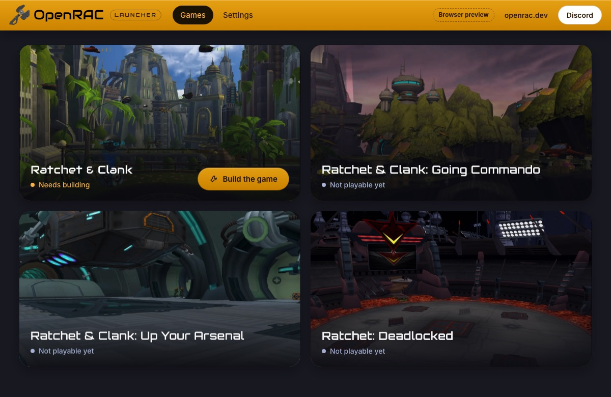
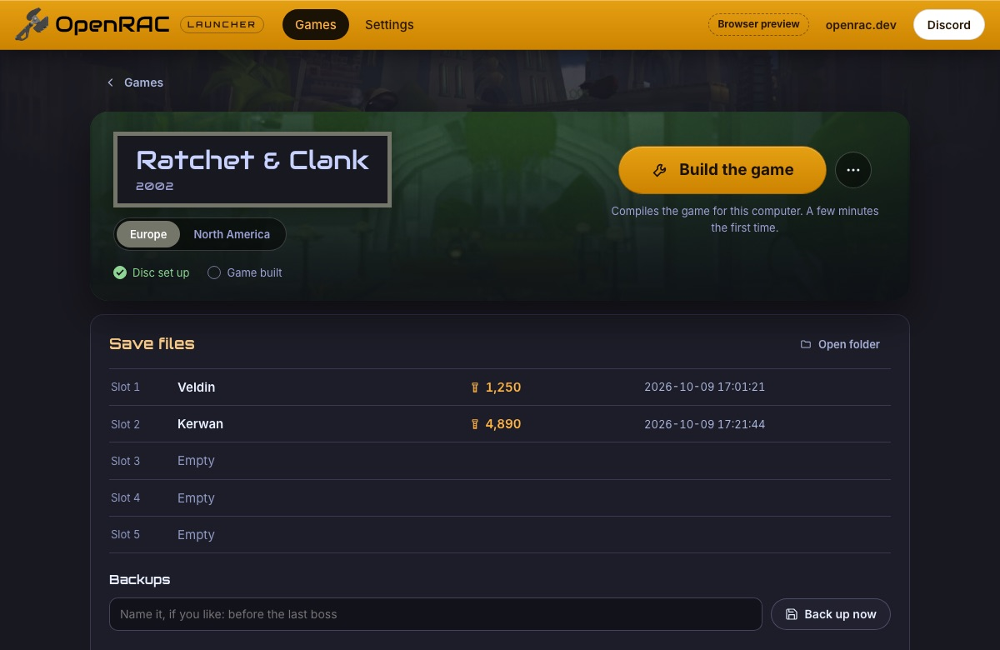

# OpenRAC Launcher

A desktop app for the Ratchet & Clank games through OpenRAC, for all five
games. It is to OpenRAC what [OpenGOAL's launcher](https://github.com/open-goal/launcher)
is to Jak and Daxter: a player sets a game up from the image of their own
disc, plays the **native PC port**, and can open the levels in Godot to edit
them. **There is no emulation**: the launcher never runs the retail program
or a model of the console ([docs/port](../docs/port/README.md)).

Ratchet & Clank (PAL) builds and runs from the launcher on Windows, Linux
and macOS: **Build the game** compiles its native port ([port/](../port/README.md)),
**Play** starts it. The port is not complete yet, and the other versions
are not playable yet: their Play says what is missing. With
**developer tools** switched on in Settings, the launcher is also a
contributor's console: place what each decompilation's build needs, set up
the toolchains, build, check, and see each decompilation's progress. Either
way it runs the same commands a contributor types, from the user's own
OpenRAC checkout, and shows their output live.

**An installed launcher needs nothing but your disc image.** Its installer
carries a copy of what the launcher uses: the game built for the system, the
set-up and level tools and a Python to run them
([tools/bundle_standalone.py](../tools/bundle_standalone.py); the
[launcher workflow](../.github/workflows/launcher.yml) puts it together). The
launcher uses that copy when it finds no OpenRAC checkout, and a contributor's
checkout, when there is one, goes first. With the copy there is nothing to
build: the steps are the disc, the levels, Play.

It is a [Tauri 2](https://tauri.app/) app: a Rust side (`core/` and
`src-tauri/`) that does every file and process operation, and a Svelte 5 UI
(`src/`) styled after [openrac.dev](https://openrac.dev).

| Games                                                                                 | A game                                                                                           |
| ------------------------------------------------------------------------------------- | ------------------------------------------------------------------------------------------------ |
|  |  |

## Read first

| You want to                                                    | Read                                         |
| -------------------------------------------------------------- | -------------------------------------------- |
| Connect a game's set-up, build, checks or play to the launcher | [docs/INTEGRATION.md](docs/INTEGRATION.md)   |
| Understand how the parts fit, add a command or a page          | [docs/ARCHITECTURE.md](docs/ARCHITECTURE.md) |
| Change the look, add a game's colours                          | [docs/STYLE.md](docs/STYLE.md)               |
| Know where the native port stands                              | [docs/port](../docs/port/README.md)          |
| Build, package and publish a new launcher release              | [docs/RELEASING.md](docs/RELEASING.md)       |

OpenRAC's own rules apply here too ([AGENTS.md](../AGENTS.md),
[CONTRIBUTING.md](../CONTRIBUTING.md), [SOURCING.md](../docs/policy/SOURCING.md)):
the launcher never downloads, uploads or bundles a game.

## Setting a game up from your disc

OpenGOAL's flow, step for step ([docs/INTEGRATION.md](docs/INTEGRATION.md#setting-a-game-up)):

1. On a first start the Games page asks for **the folder with your
   PlayStation 2 games**. The launcher looks through it (two folders deep) for
   images of games it knows, telling a disc by the boot program its
   `SYSTEM.CNF` names, whatever the file is called
   ([core/src/discs.rs](core/src/discs.rs)), and sets each playable one up
   without further questions. The folder can be changed in Settings; a game's
   own **Set up from your disc** still asks for a single image (`.iso`, or a
   `.chd` made with `chdman createdvd`) when the folder holds none. The
   extractor and the game read a plain image by sector, so a `.chd` is
   unpacked once into `<install>/discs/<name>.iso` first
   ([core/src/chd.rs](core/src/chd.rs)).
2. The launcher runs OpenRAC's extractor ([tools/extractor.py](../tools/extractor.py))
   as a job: it copies the disc's files into the install folder and checks
   the boot executable against the builds OpenRAC knows
   (`games/<game>/game.json`). An unknown or damaged image is refused, with
   OpenGOAL's error number for the same failure.
3. After the set-up the launcher goes on to **Get the levels ready** by itself
   (the worlds the game draws from, read from the disc: half a minute, once),
   and then has the game **check the levels**: it reads every one as it will
   when played and names any it cannot draw. Play is offered only after that
   check; levels that fail it are read from the disc again, once, and checked
   again. Without it an export cut short was a black world behind the HUD.
4. In a checkout, **Build the game** runs [tools/build_port.py](../tools/build_port.py): it
   compiles the native port for this computer (a few minutes the first time).
   **Rebuild the game**, in the game's menu, deletes what was built and
   compiles everything again; Play never builds a game that is built. After
   an update that changed what the game is built from (a new version, or a
   `git pull` that touched `port/`, the game's decompilation or the build),
   the game page recommends a rebuild in a notice with **Rebuild now**; Play
   still starts the build there is. A pull of docs or of another game
   changes nothing.
5. **Play** starts the port with the set-up data.

**Remove the set-up** deletes what set-up made, as OpenGOAL's uninstall does;
the disc image and saves are kept.

## On a game's page

- **One main button**, always in the same place, says the next thing to do:
  Set up from your disc, Build the game, Play. What is done less often
  (rebuild, open the folder, the activity log, remove the set-up) is in the
  menu beside it. Every game has this page, the same for all of them; the
  list on the left switches between them, and the Games tab opens on the one
  you used last.
- **Save files**: the port's memory card (`~/.local/share/openrac/memcard/<serial>/`
  on Linux) with each slot's planet, bolts and save time, backups you can
  restore, and the folder. **Edit** opens a slot of Ratchet & Clank in the save
  editor: the planet it loads on, bolts, health upgrades, weapons and gadgets,
  ammo, gold weapons, gold bolts, planets and skill points. **Advanced save
  editing** (Settings) adds every field and each part of the file as raw bytes,
  for debugging. It refuses to write while the game runs
  with that card, backs the card up before every write, and offers Undo
  ([docs/ARCHITECTURE.md](docs/ARCHITECTURE.md#the-save-editor)).
- **When the game crashes**: the game's page says "The game stopped
  unexpectedly". Your saves are kept. To help us fix it, press **Copy
  report** and paste it in a [GitHub issue](https://github.com/OpenRAC/OpenRAC/issues)
  or on the Discord, or **Save report** for a .zip in your Downloads folder
  to attach. Say what you were doing. Nothing personal goes in: your home
  folder reads `~`.
- **Logs and crash reports**, under the save files: each time you played
  and each crash, newest first, with the same Copy and Save, under **Help**
  beside the saves. A recent crash marks the game in the list.
  **Detailed logs** makes the game write more, for
  when we ask for it.
- **Differences from the original**, for a game with a port: what it does
  otherwise than the PS2 game, and why, in three groups. **Game fixes** have
  a switch each: off, the game plays as the console does (the 4:3 culling at
  the sides of a wide picture, for one). The switch is the port's own setting
  (`fix_... = 1` in its settings file), the same the game's Options menu
  changes, and it counts from the game's next start. **Kept from crashing**
  are never switched off, and **Playing on a PC** is for the record. The list
  is `port/game/<game>/differences.json` (the checkout's, else the copy the
  launcher carries; [docs/port/SETTINGS.md](../docs/port/SETTINGS.md#8-game-fixes-and-the-differences-from-the-original)).
- **Level editor**: under **Mods** (below), and in the game's menu.
- **Two discs of a game, for developers**: with developer tools on and both
  a game's PAL and NTSC-U images in the games folder, a small **Disc** switch
  under Play picks which one the page plays; Play, the levels, saves, logs and
  crash reports follow it, and the choice is remembered. Each disc keeps its
  own set-up, levels and build: switching moves the other's set-up aside
  (`iso_data/<game>@<version>`), never reads it again or deletes it
  ([core/src/disc_choice.rs](core/src/disc_choice.rs)). Players never see it,
  and with one disc nothing changes.
- **Layout**: Settings → Launcher switches between Compact (the default:
  the game's name and its main button side by side) and Classic, stacked and
  centred. Compact is one stylesheet, `src/layouts/compact.css`.

## Mods

**Gameplay mods** come first for a game the port plays: native mods, small
programs the game loads at its start that change how it plays (Ratchet &
Clank's lock-strafe is the first, in
[OpenRAC/rac1-mods](https://github.com/OpenRAC/rac1-mods)). **Add a .zip**
or a folder (or drop one on the page) installs one into the game's set-up
folder, `<data>/plugins/<id>`; each has a switch, its place in the load
order, its settings from its manifest and Remove in its menu, and says in a
few words why it cannot load when it cannot (another disc, a newer mod
interface, a missing or conflicting mod, or what the game said at its last
start). The launcher writes the list the game reads, `<data>/plugins/plugins.json`;
changes count from the game's next start. **Purist mode** (on the tab and in
Settings) starts the game with none of them. How mods work and how to write
one: [docs/port/MODS.md](../docs/port/MODS.md) and the [SDK](../sdk).

The Mods tab also has, for each game that can be edited (Ratchet & Clank, PAL and
NTSC-U), the three steps of modding in order: **Open the editor** (choose a
level: each is a Godot 4 project of its own under `assets/levels/<game>`, so
only that level loads; the first time they are read from the disc), **Pack** (turns the
edits into the game's own level data, in `assets/packed/<game>`) and **Play**
with them (the port's `--mods`). The disc image is never changed. With
developer tools on, the page also shows the folders and the three commands
behind the buttons ([editor/README.md](../editor/README.md#pack-your-edits)).

Going Commando, Up Your Arsenal and Deadlocked (NTSC-U) are there in early
access: their levels open in Godot to look around, and **Models and
textures** works for them (their levels are read for it with **Read the
levels**, since their game page has no Play yet). The page says what is not
there: edits are not packed back into those games, and they are not
playable, so their packs wait in Your mods until they are
([editor/README.md](../editor/README.md#the-later-games-early-access)).

Below them, **Models and textures**: export a level's models (glTF, with
their skeletons) and textures (PNG) to a folder that opens when it is ready,
import the edited folder back as an overrides pack, and manage the packs:
on or off, their order, remove, add a .zip or a folder (or drop one on the
page). Play with your mods puts the packed levels and the packs that are on
together first ([editor/MODDING.md](../editor/MODDING.md)).

What a contributor needs and a player does not is behind **Developer tools**
(Settings → Launcher): decompilation progress, disc serials, the Tasks tab,
file names and sizes of the saves, and the checks' details in Settings.

## Develop

You need Node 20+, Yarn (the version `package.json` names, through Corepack:
`corepack enable`) and Rust (stable). For the desktop app on Linux, Tauri's
system libraries too (Debian and Ubuntu:
`libwebkit2gtk-4.1-dev libgtk-3-dev librsvg2-dev libsoup-3.0-dev`; see
[Tauri's prerequisites](https://tauri.app/start/prerequisites/) for the others).
On Windows, Tauri builds with Rust's MSVC toolchain; if your default is the GNU
one, `rustup override set stable-x86_64-pc-windows-msvc` in this folder.

```sh
cd launcher
yarn install
yarn dev           # the UI in a browser at http://localhost:1430, with mock data (no Rust needed)
yarn tauri dev     # the desktop app, with the real Rust side
yarn tauri build   # an installer for this platform, in target/release/bundle/
```

The browser preview (`yarn dev`) reads the real `games/*/game.json`,
`progress/summary.json` and `actions.json`, and makes up the rest (which
games are set up, what a job prints): see `src/lib/mock.ts`. Add `?setup` to
the address for the first-run screen, `?version=rac1/pal` for a game page,
`?page=tasks` for Tasks.

The installers are also built by GitHub
([launcher.yml](../.github/workflows/launcher.yml)) for Windows, Linux and
macOS, on every change to `launcher/` on `master` and on pull requests:
they are the run's artifacts, under Actions. A tag `launcher-v<version>`
puts them on a draft release as well. They are not signed.

## Check

```sh
yarn verify                                            # svelte-check, ESLint, Prettier, Vitest
cargo test -p openrac-launcher-core                    # the Rust logic; no WebKit needed
cargo clippy --workspace --all-targets -- -D warnings  # needs Tauri's system libraries
cargo fmt --all --check
python3 -m unittest discover -s ../tools               # includes the extractor's tests
```

`cargo test -p openrac-launcher-core` also checks `actions.json` against the
checkout: every version key exists in a game.json, no duplicate ids, only known
placeholders, every `docs` path exists. CI runs all of these
(`.github/workflows/checks.yml`, the `launcher` job).

## Layout

```
launcher/
├── actions.json        what the launcher can run, per version: the file to edit to connect a game
├── core/               Rust, no window: games, actions, status, set-up, settings, detection, jobs,
│                       Discord presence (+ tests)
├── src-tauri/          the desktop app: Tauri commands over core/, window and bundle config, icons
├── src/                the UI: Svelte 5 + TypeScript
│   ├── lib/            api.ts (commands and types), mock.ts (browser preview), app state, queue, themes
│   ├── components/     header, game card, action card, progress bar, path field, toasts, icons
│   └── pages/          Library, Game (player and developer views), Tasks, Settings (also the first run)
├── public/             the wrench logo and favicon (from openrac-site), game backdrops and previews (img/)
└── docs/               ARCHITECTURE, INTEGRATION, STYLE
```

## What it writes, and what it connects to

- **Its settings**: `launcher.json` in the per-user config folder
  (`~/.config/dev.openrac.launcher/` on Linux,
  `~/Library/Application Support/dev.openrac.launcher/` on macOS,
  `%APPDATA%\dev.openrac.launcher\` on Windows). Settings shows the path.
- **Games set up from discs**: the install folder (Settings; by default
  `OpenRAC` in your home folder: `~/OpenRAC`, `%USERPROFILE%\OpenRAC`), `active/<game>/data/`, as OpenGOAL lays
  it out (a developer's other disc of the same game waits beside it as
  `iso_data/<game>@<version>`). The game writes its logs there (`openrac-<id>.log` and the five
  before it) and its crash reports (`crashes/`).
- **Gameplay mods**, only when you add, switch, order or remove one: the game's
  `<data>/plugins/` (each mod's folder and `plugins.json`).
- **Its own log**: `launcher.log` beside `launcher.json`: when it started,
  each command it ran and how it ended; moved to `launcher.1.log` past 1 MB.
- **A saved report**: `OpenRAC-<report>.zip` in your Downloads folder, only
  when you press Save report.
- **The memory card**, only when you ask: a backup (`.backup_<time>…` beside the
  game's folder in the card), a restored backup, or a slot changed in the save
  editor, always after a backup of the whole card.
- **Through the tools it runs**: whatever those tools write in the checkout
  (`baserom/` inputs, build output, `assets/godot` for the level editor), all
  ignored by git.
- **Progress from openrac.dev**: at start-up it fetches
  `https://openrac.dev/progress.json` and keeps a copy in the per-user
  folder beside its settings (`progress.json` next to `launcher.json`), for
  the next start without a network. That folder is the player's own to
  write, unlike a checkout the launcher does not own (the copy an
  installed launcher carries). A version shows the site's figures only
  where they are ahead of the checkout's own `progress/summary.json`, which
  the launcher never writes.
- **Discord**: unless switched off in Settings, Discord's Rich Presence shows
  the game being viewed, set up, built or played. While a game plays, Discord
  says "Playing Ratchet & Clank", "Exploring Kerwan · Metropolis" and the
  player's bolts, with the time on that planet (the port logs each level it
  enters and its bolts), and links to openrac.dev and GitHub. It talks to
  Discord's local socket (Linux, macOS) or named pipe (Windows), under
  OpenRAC's Discord application. Its images are that application's art
  assets, uploaded in Discord's Developer Portal: `openrac`
  ([docs/discord/openrac.png](docs/discord/openrac.png)) in the launcher, and
  while a game plays its logo, named after the game (`rac1` to `rac4`), which
  is not kept in OpenRAC.
- **Linux desktop integration**: at every start it writes its icons to
  `~/.local/share/icons/hicolor/` and two `.desktop` files to
  `~/.local/share/applications/`, and refreshes the desktop's caches.

## License and credits

The launcher is under the GNU GPL v3 or later, as the rest of OpenRAC's top
level ([LICENSE.md](../LICENSE.md), [COPYING](../COPYING)). It takes its
look, logo and favicon from the OpenRAC website (MIT) and bundles three fonts
(SIL Open Font License); see [THIRD_PARTY_NOTICES.md](THIRD_PARTY_NOTICES.md).
Its design follows the T3SDK launcher for Thief: Deadly Shadows (MIT), and two
small helpers are adapted from it; its disc set-up follows OpenGOAL's launcher
and extractor (ISC), from their documented behaviour, with no code taken.
